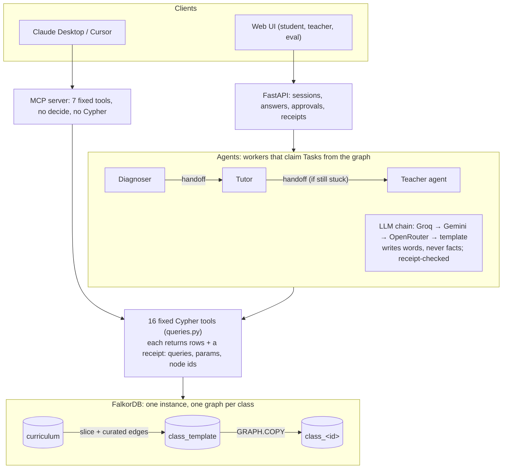

# Unlearn

> **Remove-FalkorDB test:** without the graph there is no misconception-to-concept grounding, no prerequisite root-cause traversal, no per-class memory, no agent handoffs and no cohort grouping. It collapses into generic chat.

<!-- PARTH: rewrite in your own words -->
Two students both score 40% on fractions and need opposite fixes. Asha can't find a lowest common multiple, a skill from a different topic, two steps below the question she got wrong. Ben changes only the denominator when he makes an equivalent fraction. A chat tutor sees two 40%s. Unlearn asks a few adaptive questions, traces each wrong answer back through a graph of prerequisites to the skill that actually broke, and remembers it next session. Every claim it makes comes with the Cypher query that proves it.

Built for **Graph Hacks (WeMakeDevs × FalkorDB)**. Tracks: **02 Agent Memory and Coordination** (primary) and **01 Agents That Act on Connected Data** (secondary).

## Why I built this

<!-- PARTH: rewrite in your own words -->
A percentage tells a teacher how much went wrong, never why. Most wrong answers in maths aren't random: they're a misconception, and the misconception usually lives in an earlier skill. Eedi's misconception graph maps thousands of those misconceptions to the skills they show up in. Add the links between skills, and "why" becomes a graph traversal instead of a guess.

## How it works



- **Diagnoser.** Opens with `recall`, then asks adaptive questions. It searches top-down over `REQUIRES`: a right answer rules out that skill and everything below it, and a wrong answer makes it a suspect to search beneath. It stops when `root_cause` is confident. Every step's state lives in the graph (`Task`, this session's `ATTEMPTED` edges), so each HTTP request runs exactly one step.
- **Tutor.** Explains the root cause with the remediation skill that has worked best so far, asks one check question, and updates that skill's success rate. If the student is still stuck, it hands off to the Teacher agent.
- **Teacher agent.** Looks at cohorts (WCC), keystones (PageRank) and bridges (betweenness), then writes a **Proposal**. Nothing changes until a human approves it. On approval, an executor applies the change from the graph's own edges and logs an `Event`.
- **Receipts everywhere.** Every tool call returns `{cypher, params, rows, node_ids}`. The UI's drawer shows them, and the LLM's words are rejected if they name a construct or misconception that isn't in that turn's rows.

## Graph data model

Three kinds of graph live in one FalkorDB instance:
- `curriculum`: the full Eedi graph, read-only.
- `class_template`: the Fractions slice plus the curated edges, questions and skills.
- `class_<id>`: one per classroom, made with `GRAPH.COPY`, which carries all 9 indexes, including the vector index.

FalkorDB serialises writes per graph, so classes don't queue behind each other's writes (measured below).

```
// Curriculum (in curriculum and class graphs)
(:Subject {id,name})-[:HAS_TOPIC]->(:Topic {id,name})-[:HAS_SUBTOPIC]->(:SubTopic {id,name})-[:HAS_CONSTRUCT]->(:Construct {id,name,pagerank})
(:Misconception {id,name,embedding})-[:SEEN_IN {pct, w}]->(:Construct)   // w: share of the misconception's pct within the class slice
(:Construct)-[:REQUIRES {source:'curated', weight:1}]->(:Construct)   // (needs)-[:REQUIRES]->(prerequisite)
(:Construct)-[:SHARES_MISCONCEPTION {n}]->(:Construct)                 // curriculum graph only, derived

// Assessment (class graphs)
(:Question {id,text})-[:ASSESSES]->(:Construct)
(:Option {qid,key,text,correct})-[:OPTION_OF]->(:Question)
(:Option)-[:INDICATES]->(:Misconception)                               // wrong options only

// Memory (class graphs)
(:Student {id,alias})-[:ATTEMPTED {ts,session,option,correct}]->(:Question)
(:Student)-[:SHOWED {count,confidence,first_ts,last_ts}]->(:Misconception)
(:Student)-[:MASTERED {ts,evidence}]->(:Construct)
(:Student)-[:HAD_SESSION]->(:Session {id,ts,n})-[:HAD_EVENT]->(:Event {id,type,ts,summary})
(:Event)-[:ABOUT]->(:Misconception|:Construct)
(:Skill {name,success_rate,uses})-[:REMEDIATES]->(:Misconception)
(:Skill)-[:HAS_STEP {order}]->(:Step {text})

// Coordination (class graphs)
(:Agent {name})                                                        // Diagnoser, Tutor, Teacher
(:Task {id,kind,state,claimed_by,created_ts,construct_id,session})-[:ABOUT]->(:Student)
(:Task)-[:ASSIGNED_TO]->(:Agent)
(:Task)-[:HANDED_OFF_FROM]->(:Task)
(:Proposal {id,kind,state,payload})-[:FOR]->(:Student)                  // waits for teacher approval
(:Proposal)-[:HAD_EVENT]->(:Event)                                     // logged when an approval is applied
(:Group {id})-[:HAS_MEMBER]->(:Student)                                // applied regroup
(:Assignment {id,ts,proposal})-[:FOR]->(:Student), (:Assignment)-[:PRACTICES]->(:Construct)
(:Student)-[:SHARES_GAP {miscs}]->(:Student)                            // derived for cohorts
```

| Memory type (Track 02) | Where it lives | Example |
| --- | --- | --- |
| Episodic | `Session`, `Event`, `ATTEMPTED` | "On Oct 17 Asha picked C on q-345-2" |
| Semantic | `SHOWED`, `MASTERED` | "Asha finds a common multiple but not the lowest" |
| Procedural | `Skill` → `Step`, with `success_rate` | "LCM-first common denominators worked 3 of 4 times" |
| Shared state | `Task`, `Proposal` | "Diagnoser handed Asha to the Tutor" |

### The hero query: `root_cause`

```
MATCH (s:Student {id:$sid}), (c:Construct {id:$cid})
MATCH p = (c)-[:REQUIRES*1..4]->(pre:Construct)
WHERE NOT (s)-[:MASTERED]->(pre)
WITH s, pre, min(length(p)) AS depth
OPTIONAL MATCH (s)-[e:SHOWED]->(m:Misconception)-[si:SEEN_IN]->(pre)
WITH pre, depth, sum(coalesce(e.count, 0) * coalesce(e.confidence, 0.0) * coalesce(si.w, 0.0)) AS evidence, collect(DISTINCT m.name) AS miscs
WHERE evidence > 0
RETURN pre.id AS id, pre.name AS name, depth, evidence, miscs
ORDER BY evidence DESC, depth DESC LIMIT 3
```

It walks up to four prerequisite hops back from the skill the student is working on. It ranks every unmastered prerequisite by misconception evidence, weighted by how specific each misconception is to that skill (`SEEN_IN.w`). Ties go to the deeper prerequisite, because the deepest broken skill is the real cause.

## Every query

<!-- queries:start -->
109 queries, all parameterised, all in [`api/unlearn/queries.py`](api/unlearn/queries.py).

**Agent tools (the 16 tools and the queries they run)**

| Query | Purpose | FalkorDB feature |
| --- | --- | --- |
| `RECORD_ATTEMPT` | `record_attempt`: store an answer and return the misconception behind the chosen option | MATCH + CREATE edge |
| `UPDATE_SHOWED` | `record_attempt`: semantic memory, confidence 1 − 0.5^count | MERGE ON CREATE / ON MATCH |
| `MASTERY_EVIDENCE` | `record_attempt`: correct answers and the strongest misconception on a construct | aggregation |
| `MARK_MASTERED` | `record_attempt`: mark MASTERED when earned | MERGE |
| `DIAGNOSE_TEXT` | `diagnose_text`: free-text explanation to this construct's misconceptions | vector index (`db.idx.vector.queryNodes`) + traversal filter |
| `NEXT_QUESTION` | `next_question`: a question not asked this session, fresh first, probing unshown misconceptions | pattern predicates (`NOT (s)-[:ATTEMPTED {session}]->(q)`) |
| `QUESTION_OPTIONS` | `next_question`: the question's options | traversal |
| `ROOT_CAUSE` | `root_cause`: unmastered prerequisites ranked by weighted misconception evidence, deeper wins ties | variable-length `REQUIRES*1..4`, aggregation |
| `ROOT_CAUSE_CHAIN` | `root_cause`: the REQUIRES chain from target to root cause, for the receipt | variable-length path |
| `PROBE_FRONTIER` | `probe_frontier`: deepest unmastered, unprobed prerequisites | variable-length path + pattern predicates |
| `LEARNING_PATH` | `learning_path`: teaching order, deepest first | variable-length `REQUIRES*0..6` |
| `LEARNING_PATH_SP` | `learning_path`: shortest chain to one construct | `algo.SPpaths` |
| `RECALL` | `recall`: confident misconceptions with their latest events | episodic + semantic traversal |
| `PICK_SKILL` | `pick_skill`: best remediation skill for a misconception | procedural memory |
| `SKILL_STEPS` | `pick_skill`: the skill's ordered steps | traversal |
| `UPDATE_SKILL` | `update_skill`: success rate with a +2/+3 prior | two ordered SETs |
| `SKILL_BY_NAME` | `update_skill`: read the updated skill back | index lookup |
| `COHORTS_CLEAR` | `cohorts`: drop the old gap-sharing edges | DELETE |
| `COHORTS_LINK` | `cohorts`: link students who share a confident misconception | pattern match + CREATE |
| `COHORTS_WCC` | `cohorts`: group students into cohorts | `algo.WCC` |
| `KEYSTONES` | `keystones`: constructs most of the topic depends on | `algo.pageRank` |
| `SET_PAGERANK` | `keystones`: write scores back | UNWIND + SET |
| `BRIDGES` | `bridges`: constructs where misconceptions cross topics (curriculum graph) | `algo.betweenness` (fixed seed) |
| `CLAIM` | `claim`: oldest submitted task for an agent; exactly one worker wins | per-graph write serialisation |
| `HANDOFF` | `handoff`: close a task, open the next, keep the chain and its context | CREATE + SET in one write |
| `PROPOSE` | `propose`: a pending Proposal for the teacher | CREATE + UNWIND |
| `DECIDE` | `decide`: approve or reject a pending proposal | conditional MATCH + SET |

**Approval executor (runs only after `decide(approved)`)**

| Query | Purpose | FalkorDB feature |
| --- | --- | --- |
| `EXEC_REGROUP` | regroup: `(:Group)-[:HAS_MEMBER]->(:Student)` for the proposal's FOR students | MERGE |
| `EXEC_SKIP_AHEAD` | skip_ahead: MASTERED {evidence:'teacher_override'}, never over an earned one | MERGE ON CREATE |
| `EXEC_ASSIGN_PRACTICE` | assign_practice: `(:Assignment)-[:FOR]->(:Student)`, `-[:PRACTICES]->(:Construct)` | CREATE |
| `LOG_PROPOSAL_EVENT` | log the applied change as an Event on the Proposal | CREATE + FOREACH/CASE |

**Sessions, tasks and steppable agents**

| Query | Purpose | FalkorDB feature |
| --- | --- | --- |
| `START_SESSION` | open a Session (n = previous sessions + 1) | aggregation + CREATE |
| `LOG_EVENT` | episodic memory: an Event ABOUT a misconception and/or construct | CREATE + FOREACH/CASE |
| `CREATE_TASK` | the first task of a chain, with its construct and session | CREATE |
| `TASK_CONTEXT` | a task's student, construct, session and pending question | traversal |
| `TASK_STATE` | a task's state (claim-race test) | index lookup |
| `COMPLETE_TASK` | end a chain without handing off | SET |
| `FAIL_TASK` | mark a task failed so the session ends | SET |
| `CLAIM_TASK` | claim one specific task (an HTTP request driving its own session) | per-graph write serialisation |
| `CLAIM_IN_SESSION` | CLAIM limited to one session (simulated sessions) | per-graph write serialisation |
| `OPEN_TASKS_FOR` | read-only check before the API's Teacher worker claims | GRAPH.RO_QUERY |
| `SET_PENDING` | the question a task is waiting on | SET |
| `SET_TUTOR_PLAN` | what the Tutor taught, for the check answer's request | SET |
| `SESSION_TASKS` | a session's tasks (routes an HTTP answer) | property match |
| `SESSION_ATTEMPTS` | this session's answers in order: the Diagnoser's search state | edge property filter |
| `SESSION_RULED_OUT` | constructs answered right this session plus everything they depend on | variable-length `REQUIRES*0..6` |
| `SESSION_LOOKUP` | which student a session belongs to | traversal |
| `STUDENT_SESSIONS` | a student's sessions | traversal |
| `SESSION_SCORE` | correct / answered in one session | aggregation |
| `CHAIN` | every task handed off from a root task | variable-length `HANDED_OFF_FROM*0..` |
| `CHAIN_OPEN` | open tasks in a chain (session end) | variable-length path |
| `SHOWED_ON` | a student's misconceptions on one construct, by weighted evidence | traversal + SEEN_IN.w |
| `STUDENT_SHOWED` | all of a student's SHOWED edges | traversal |
| `NAME_VOCABULARY` | every construct and misconception name, for the LLM receipt check | label scan |
| `PROPOSALS` | proposals by state, with their students | aggregation |
| `PROPOSAL_LOOKUP` | find a proposal's class graph | property match |

**UI, API and demo reads**

| Query | Purpose | FalkorDB feature |
| --- | --- | --- |
| `SLICE_FOR_TARGET` | graph panel: the constructs under a target | variable-length `REQUIRES*0..6` |
| `SLICE_EDGES` | graph panel: REQUIRES edges among them | variable-length path |
| `STUDENT_SHOWED_ON_SLICE` | graph panel: the student's misconceptions on the slice | traversal + IN list |
| `STUDENT_MASTERED_ON_SLICE` | graph panel: mastered constructs | traversal + IN list |
| `CLASS_STUDENTS` | students with their session counts | aggregation |
| `TARGETS` | constructs with prerequisites, deepest chains first (topic picker) | variable-length path + aggregation |
| `QUIZ_SCORES` | fractions-check scores (demo scenario) | edge property filter + aggregation |
| `LOAD_STUDENT_PROFILES` | demo scenario students and their planted simulator profile | UNWIND + MERGE |
| `STUDENT_SIM_PROFILE` | read a scenario student's profile (simulated answers only) | index lookup |
| `COUNT_NODES` | /health node counts | aggregation |
| `RESET_STUDENT_SESSIONS` | demo reset: a student's sessions and events | DETACH DELETE |
| `RESET_STUDENT_EDGES` | demo reset: attempts, evidence, mastery, gap links | multi-type edge match |
| `RESET_STUDENT_TASKS` | demo reset: the student's tasks | DETACH DELETE |
| `RESET_STUDENT_PROPOSALS` | demo reset: proposals, their events and assignments | DETACH DELETE |
| `RESET_STUDENT_GROUPS` | demo reset: group membership | DELETE |

**Eval and concurrency**

| Query | Purpose | FalkorDB feature |
| --- | --- | --- |
| `NEAREST_MISCONCEPTIONS` | condition B's retriever and the eval judge | vector index |
| `CLASS_CONSTRUCTS` | the eval judge's construct names | label scan |
| `CONC_PROBE_WRITE` | a small timed write (isolation probes) | MERGE |
| `CONC_HEAVY_WRITE` | a deliberately heavy write that holds a graph's write lock | UNWIND + CREATE |

**Loading and indexes**

| Query | Purpose | FalkorDB feature |
| --- | --- | --- |
| `CURRICULUM_INDEXES` | range indexes on Subject/Topic/SubTopic/Construct/Misconception ids | range index |
| `CLASS_INDEXES` | plus Question, Student, Task.state and the 384-d cosine vector index | range + vector index |
| `LOAD_HIERARCHY` | Subject → Topic → SubTopic → Construct from construct-map.csv | UNWIND + MERGE (batches of 500) |
| `LOAD_MISCONCEPTIONS` | misconceptions and weighted SEEN_IN edges | UNWIND + MERGE |
| `LOAD_SHARES_MISCONCEPTION` | derived SHARES_MISCONCEPTION edges (curriculum graph) | UNWIND + MERGE |
| `SLICE_CONSTRUCTS` | the class slice read out of `curriculum` | traversal + IN list |
| `SLICE_SEEN_IN` | the slice's misconceptions and SEEN_IN edges | traversal |
| `SET_SEEN_IN_WEIGHTS` | SEEN_IN.w: the misconception's share of its weight within the slice | aggregation + SET |
| `LOAD_REQUIRES` | curated REQUIRES edges | UNWIND + MERGE |
| `LOAD_QUESTIONS` | questions ASSESSES constructs | UNWIND + MERGE |
| `LOAD_OPTIONS` | options, and INDICATES for wrong ones | UNWIND + FOREACH/CASE |
| `LOAD_SKILLS` | remediation skills | UNWIND + MERGE |
| `LOAD_SKILL_STEPS` | ordered skill steps | UNWIND + CREATE |
| `LOAD_REMEDIATES` | skill → misconception | UNWIND + MERGE |
| `LOAD_AGENTS` | Diagnoser, Tutor, Teacher | UNWIND + MERGE |
| `LOAD_EMBEDDINGS` | misconception embeddings | `vecf32` |
| `LOAD_STUDENTS` | synthetic students | UNWIND + MERGE |

**Checks used by the loaders and tests**

| Query | Purpose | FalkorDB feature |
| --- | --- | --- |
| `COUNT_NODES_BY_LABEL` | node counts per label | aggregation |
| `COUNT_EDGES_BY_TYPE` | edge counts per type | aggregation |
| `COUNT_SEEN_IN` | SEEN_IN count (19,294 expected) | aggregation |
| `COUNT_HIERARCHY_EDGES` | hierarchy edge counts | aggregation |
| `COUNT_SHARES_MISCONCEPTION` | derived edge count | aggregation |
| `ASYMMETRIC_SHARES_MISCONCEPTION` | every derived edge has its reverse | pattern predicate |
| `SEEN_IN_PCT_SUMS` | each misconception's pct sums to 100 | aggregation |
| `LIST_INDEXES` | indexes survive GRAPH.COPY | `db.indexes()` |
| `COUNT_EMBEDDED` | every misconception has a vector | aggregation |
| `REQUIRES_MAX_DEPTH` | longest REQUIRES chain | variable-length path |
| `REQUIRES_PROPS` | REQUIRES edges carry source and weight | aggregation |
| `SHOWED_ON_WEIGHTS` | SEEN_IN pct and w for one misconception | traversal |
| `GROUP_MEMBERS` | approval test read-back | traversal |
| `ASSIGNMENTS_FOR` | approval test read-back | traversal |
| `MASTERED_EDGE` | approval test read-back | traversal |
| `PROPOSAL_EVENTS` | approval test read-back | traversal |
| `COUNT_LABELS` | rejection changes nothing | aggregation |
<!-- queries:end -->

## Evaluation

**Method** (`eval/run_eval.py`, per the build spec):
- **Students:** 30 simulated students × 3 seeds × 2 sessions.
- **Planted state:** each student has one planted broken prerequisite and 1–3 planted misconceptions.
- **Simulator:** rule-based and seeded (`eval/simulator.py`).
  - If an option shows a planted misconception, the student picks it with probability 0.85.
  - On skills the student knows, they answer correctly with probability 0.9.
  - Otherwise they pick a random wrong option.
  - There is a 10% guess rate everywhere.
- **Conditions:**
  - **A: no memory.** One LLM call per wrong answer, seeing only that question.
  - **B: vector RAG.** The full attempt history as text, plus the top-10 misconceptions retrieved from FalkorDB's vector index by embedding each question with the chosen option.
  - **C: Unlearn.** The agents, through the same step API the web UI uses.
- **Same questions and LLM:** A and B ask a seeded sample of 6 questions from the same pool C draws from (the target and everything it depends on), and use the same LLM, with a disk cache.
- **One judge for everyone:** guesses are mapped to misconceptions and skills by embedding similarity. Session-2 recall means the opening message names a planted misconception.

**Results** (from [`eval/results/eval.json`](eval/results/eval.json); mean, with min–max across seeds):

| Metric | A. No memory | B. Vector RAG | C. Unlearn |
| --- | --- | --- | --- |
| Top-1 misconception | TODO | TODO | 47% (40–50%) |
| Top-3 misconception | TODO | TODO | 78% (73–87%) |
| Root-cause accuracy | TODO | TODO | 73% (67–80%) |
| Questions to diagnosis | TODO | TODO | 5.3 (5.2–5.4) |
| Session-2 recall | TODO | TODO | 30% (27–33%) |
| p50 latency per diagnosis (ms) | TODO | TODO | 49 (49–49) |

TODO: A and B need an LLM API key and have not been run yet. Nothing in their columns is estimated.

**Simulator bias, stated plainly.** The simulator picks wrong answers through the same option-to-misconception map Unlearn reads. That favours Unlearn: a real student's wrong answer is messier than the map. The noise above (a 10% guess rate, 15% of planted misconceptions not picked) is there to blunt that, not remove it.

Session-2 recall is low because `recall` only returns misconceptions held with confidence above 0.6, which means seen at least twice. With five noisy questions, most students show their planted misconception only once. If one sighting were enough, recall would be 81%, at the cost of recalling some one-off slips.

### Concurrency (`eval/concurrency.py`, [`eval/results/concurrency.json`](eval/results/concurrency.json))

**Both classes at once.** 30 simulated students in each of two class graphs ran at the same time through the async client. Per graph, p50 was 2.1 ms and p95 18 ms across 360 answers' worth of queries.

**Isolation.** These are small probe writes into class A, timed from a separate process with its own connection:

| Load while probing class A | p50 ms | p95 ms |
| --- | --- | --- |
| None (baseline) | 0.33 | 0.38 |
| Heavy writes on **class B** | 0.57 | 28.3 |
| Heavy writes on **class A** | 294 | 569 |
| 30 students' sessions on class B | 70 | 79 |
| 30 students' sessions on class A | 70 | 77 |

- **Write locks are per graph.** A's writes don't queue behind B's writes, only behind A's own.
- **Threads and CPU are shared.** A load that fills the server's query thread pool (`THREAD_COUNT` 15 here) slows every class equally.

Tool latency for all 16 tools, 50 calls each, is in [`eval/results/latency.json`](eval/results/latency.json). Every class-graph tool is under 5 ms at p95.

## How Unlearn differs from Atrium

Atrium won FalkorDB's own "Memory Meets Motion" hackathon by grouping students by misconception. Unlearn keeps that grouping (`cohorts`, WCC over shared misconceptions) and adds what a grouping can't tell a teacher:
- **Why.** `root_cause` traverses prerequisites to the skill that broke, often in another topic.
- **Memory across sessions.** Session 2 opens with what session 1 found.
- **Multi-agent handoff through the graph.** Tasks are claimed, handed off and approved, all as graph state.
- **A human approval gate.** Nothing the agents propose takes effect until a teacher approves it.
- **An MCP server** over the same fixed tools.
- **A measured eval** against vector RAG and no memory.

## Data, licences and what is synthetic

| Source | What | Status | Licence |
| --- | --- | --- | --- |
| [Eedi Misconceptions Graph v1.0](https://huggingface.co/datasets/Eedi/Eedi-Misconceptions-Graph), pinned to commit `2ae0839debf73c0ce7dd6578d8ea8b99e7be8631` | 2,258 constructs (Subject → Topic → SubTopic hierarchy), 8,117 misconceptions, 19,294 weighted misconception↔construct edges | Real | CC BY 4.0 |
| `data/curated/requires.csv` | 59 prerequisite edges between 40 constructs | Authored (AI draft, human review) | MIT (this repo) |
| `data/curated/questions.json` | 120 multiple-choice questions, each wrong option tied to an Eedi misconception, maths checked with `fractions.Fraction` | Authored (AI draft, human review) | MIT |
| `data/curated/skills.json` | 8 remediation skills | Authored (AI draft, human review) | MIT |
| Students, attempts, sessions | 30 simulated students in `class_demo`, Asha and Ben in `class_demo_video` | Synthetic | MIT |

**Attribution** (required by the licence):

> "Eedi Misconceptions Graph v1.0" by Eedi, licensed under CC BY 4.0. Adapted: filtered to Number/Fractions for the class graphs, with curated prerequisite edges and generated questions added.

Eedi does not endorse this project. There are no real students, logins or personal data anywhere.

## Known FalkorDB issues we hit (v4.20.7) and the workarounds

| Issue | Workaround |
| --- | --- |
| `ORDER BY length(p)` on a path that isn't returned fails: "Unable to locate a value with alias p" | Return `length(p) AS hops` and order by `hops` (`ROOT_CAUSE_CHAIN`) |
| `ORDER BY` a property not projected after an aggregation fails: "cannot reference variables not projected" | Project it first (`PROPOSALS` returns `created_ts`) |
| `GRAPH.COPY` segfaulted once (signal 11) during rapid delete-and-copy cycles straight after heavy writes. It was not reproducible on its own, even with 60 back-to-back copies | Compose uses `restart: unless-stopped`; the data survived on the volume. `demo_scenario.py` retries the copy once |
| A write query against a graph that was just deleted silently recreates it, empty. Our Teacher worker's polling `CLAIM` did this to test graphs | Poll with `GRAPH.RO_QUERY` first (`OPEN_TASKS_FOR`) and claim only when a task is waiting |
| The image's default `MAX_QUEUED_QUERIES 25` rejected 60 concurrent simulated students: "Max pending queries exceeded" | Compose sets `FALKORDB_ARGS=MAX_QUEUED_QUERIES 256 TIMEOUT 1000 RESULTSET_SIZE 10000`. It restates the other defaults, because setting the variable replaces them |
| The vector query's `score` is a cosine **distance**: the exact text scores 0.0 | `ORDER BY score ASC`, checked by a test |
| `LIMIT` doesn't limit eager operations that come before it | `CLAIM` limits before it writes; 20 rounds of 10 concurrent claims each have exactly one winner |
| All graphs share one query thread pool, so a saturating load on any class slows every class | A capacity limit rather than a bug; the measured numbers are above |

Good news: `GRAPH.COPY` carries every index, including the vector index, into the new class graph. `algo.SPpaths`, `algo.WCC`, `algo.pageRank` and seeded `algo.betweenness` all ran unchanged.

## Local setup

You need Docker with Compose v2 (Docker Desktop, or Docker Engine with the compose plugin) and `git`. Nothing else: Python, FalkorDB, the embedding model and the Eedi data all come from the containers.

```
git clone https://github.com/pm2m1/unlearn.git
cd unlearn
cp .env.example .env
sed -i.bak "s/^FALKOR_PASSWORD=.*/FALKOR_PASSWORD=$(openssl rand -hex 16)/" .env && rm .env.bak
docker compose --profile dev up -d --build --wait
```

Then open **http://localhost:8000**.

- **First run.** `--build` takes a few minutes and bakes the embedding model and the pinned Eedi CSVs into the image. On first boot the API seeds every graph before it reports healthy (under a minute), and `--wait` returns once it has. Later starts take seconds.
- **Check it.** `curl -s localhost:8000/health` lists the graphs (`curriculum`, `class_template`, `class_demo`), their node counts and the FalkorDB version.
- **Fill the teacher view.** Open the Teacher tab and click "Simulate the class", or run `curl -X POST localhost:8000/classes/demo/simulate-all`.
- **The demo video's scenario.** Run `docker compose exec api python scripts/demo_scenario.py`, then open `http://localhost:8000/?class=demo_video`. Asha and Ben both score 40% and have different root causes; `--verify 10` replays both students 10 times.
- **Stop it.** `docker compose --profile dev down`. The graphs stay in the `falkor-data` volume. Add `-v` to wipe them; the next start re-seeds itself.
- **Optional LLMs.** Put any of `GROQ_API_KEY`, `GEMINI_API_KEY` or `OPENROUTER_API_KEY` in `.env` before starting. Without them, every reply is a template built from the graph's rows.

Both containers bind to `127.0.0.1` in the `dev` profile. `docker compose --profile prod up -d --build --wait` publishes only the API on port 8000; FalkorDB has no published port.

### Working on the code (host Python)

```
python3.12 -m venv .venv && .venv/bin/pip install -r requirements.txt
make up      # FalkorDB only, on 127.0.0.1:6379
make seed    # load curriculum, build class_template, create class_demo
make test
make serve   # the API and UI on http://localhost:8000
```

## MCP server

`api/unlearn/unlearn_mcp.py` exposes `recall`, `root_cause`, `learning_path`, `cohorts`, `keystones`, `bridges` and `propose` to MCP clients. Every tool takes a `class_id`.
- **Not exposed:** `decide`. Approval stays with the human.
- **No raw Cypher.** That's why Unlearn doesn't use FalkorDB's own MCP server, which runs arbitrary queries. Fixed domain tools keep "tool selection through MCP" safe.

Claude Desktop config (`claude_desktop_config.json`), with your clone's absolute paths:

```json
{
  "mcpServers": {
    "unlearn": {
      "command": "/ABSOLUTE/PATH/TO/unlearn/.venv/bin/python",
      "args": ["-m", "unlearn.unlearn_mcp"],
      "env": { "PYTHONPATH": "/ABSOLUTE/PATH/TO/unlearn/api" }
    }
  }
}
```

More in [docs/mcp.md](docs/mcp.md).

## AI assistance

AI assistant use is disclosed in [AI_USAGE.md](AI_USAGE.md).

## Licence

MIT for the code and the authored data. Eedi data is CC BY 4.0, attributed above.
