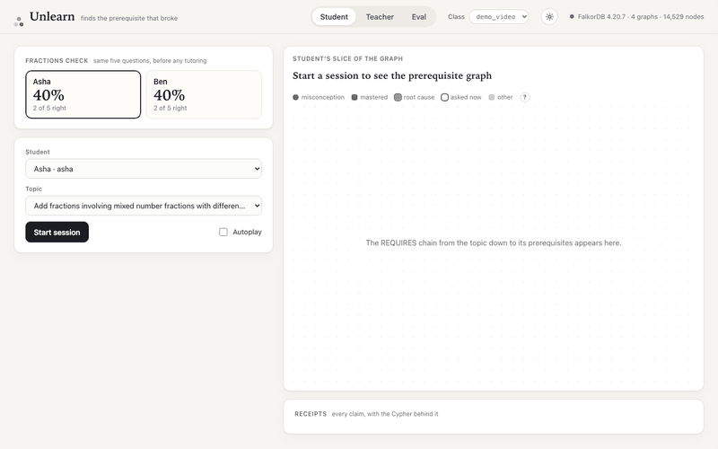
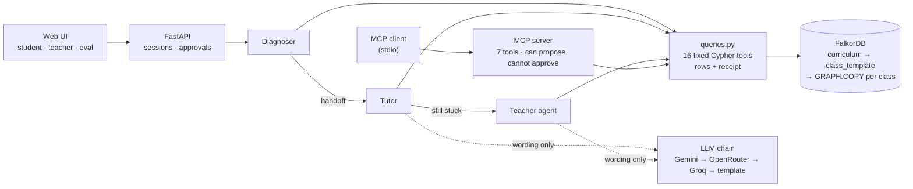
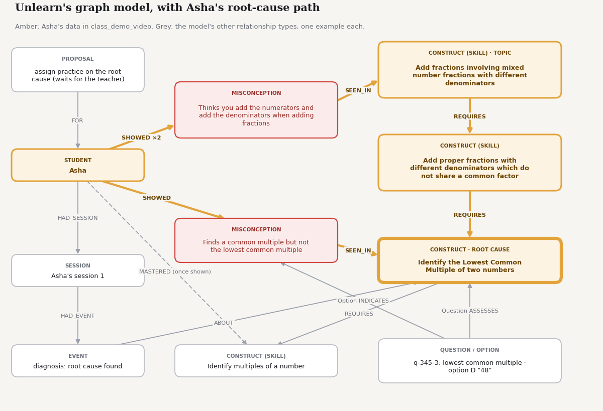
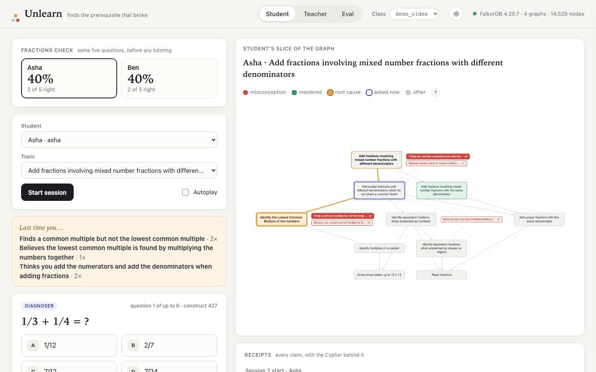
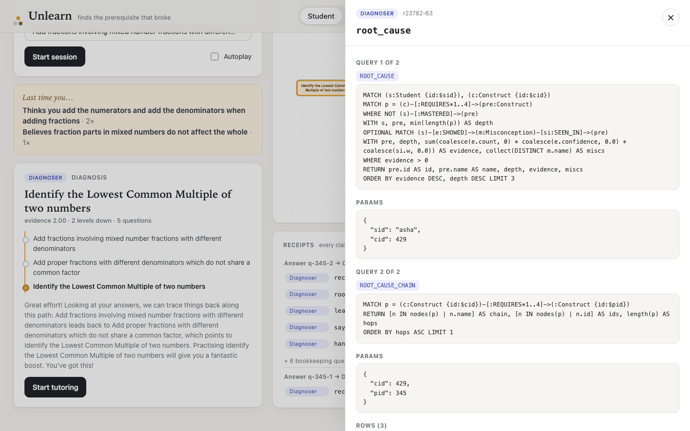
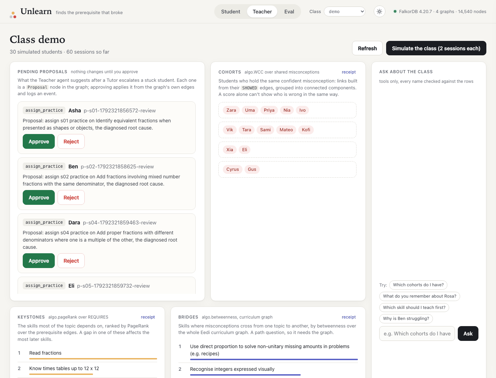
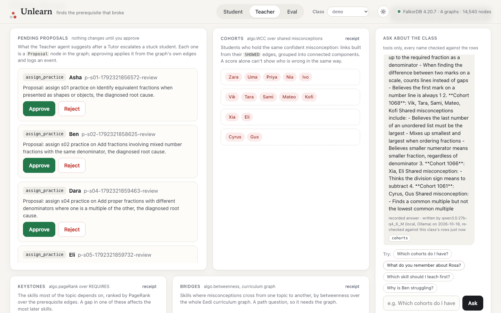
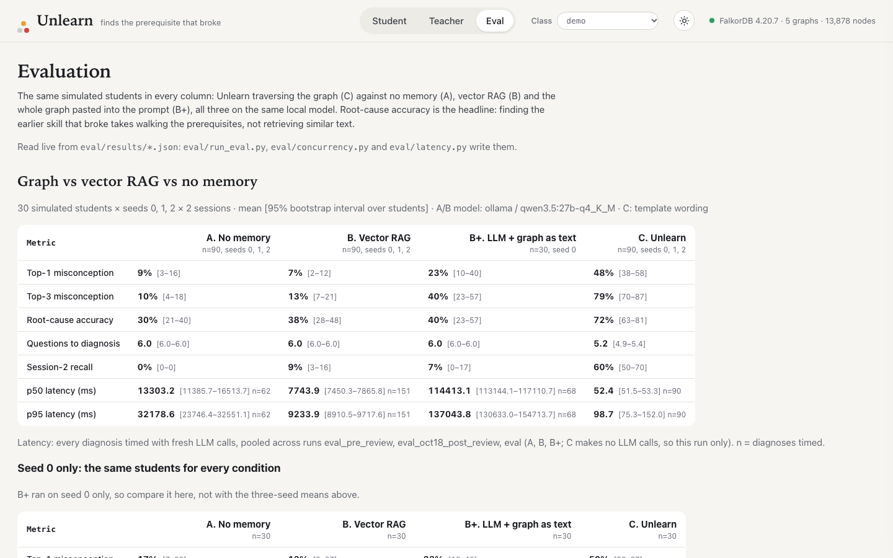
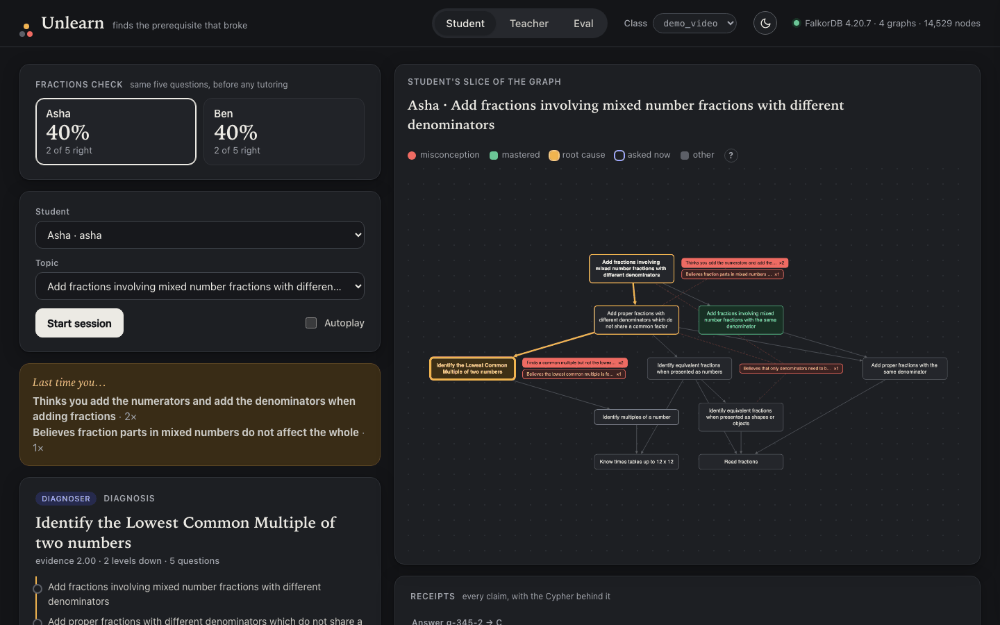

# Unlearn

Unlearn finds the earlier skill behind a student's wrong answers by walking a FalkorDB prerequisite graph, remembers it next session, and shows the Cypher behind every claim.

**Live demo: [unlearn-ejdh.onrender.com](https://unlearn-ejdh.onrender.com)** (free tier: the first load can take about a minute) · **Video:** <link> · **Code: [github.com/pm2m1/unlearn](https://github.com/pm2m1/unlearn)** · **Blog: [I gave an AI tutor a map of 8,117 ways students get maths wrong](https://dev.to/pm2m1/i-gave-an-ai-tutor-a-map-of-8117-ways-students-get-maths-wrong-240i)**



*Asha answers five questions; Unlearn walks her `REQUIRES` chain and lights up the root cause in amber: lowest common multiple, two levels below the topic she got wrong.*

> **Remove-FalkorDB test:** without the graph there is no misconception-to-concept grounding, no prerequisite root-cause traversal, no per-class memory, no agent handoffs and no cohort grouping. It collapses into generic chat.

## What it does

Two students both score 40% on fractions and need opposite fixes. Asha can’t find a lowest common multiple, a skill from another topic two steps below the question. Ben changes only the denominator when he makes an equivalent fraction. A chat tutor sees two 40%s. Unlearn asks a few adaptive questions, traces each wrong answer back through a graph of prerequisites to the skill that actually broke, remembers it next session, and shows the Cypher behind every claim.

- **Diagnoses the root cause.** The Diagnoser asks adaptive questions and walks `REQUIRES` edges down from the topic: a right answer rules a skill out, a wrong one makes it a suspect, and `root_cause` names the deepest unmastered prerequisite with misconception evidence.
- **Tutors with memory.** The Tutor explains that root cause with the remediation skill that has worked best so far, and the next session opens with what the last one found, read back from the graph.
- **Proposes, a teacher decides.** The Teacher agent groups students by shared misconceptions (WCC), ranks keystone skills (PageRank) and writes proposals; nothing changes until a human approves one.

## Why I built this

I wanted an agent problem where the answer really depends on connections, not on one record. Maths mistakes are exactly that: a wrong answer points to a misconception, which lives in a skill, which depends on other skills. The Eedi Misconceptions Graph gave me 8,117 real misconceptions to build on, and FalkorDB let me give every class its own graph and run WCC, PageRank and betweenness as agent tools instead of writing them myself.

## Architecture



The graph decides; the LLM only phrases. Every agent claim carries a receipt (query, params, node ids) checked before it is shown.

- **No state in Python.** Agents claim `Task` nodes from the graph and hand off through them, so each HTTP request runs one step.
- **One graph per class.** `class_<id>` is a `GRAPH.COPY` of `class_template`, so classes never queue behind each other's writes.
- **More:** [docs/DESIGN.md](docs/DESIGN.md) (how the agents work, design decisions, full schema, Atrium) and [docs/EXPLAIN.md](docs/EXPLAIN.md) (one-page explainer).

## Graph data model



*Amber is Asha's real path: she `SHOWED` a misconception `SEEN_IN` the topic, which `REQUIRES` two levels down to the lowest common multiple, where her diagnosis found the evidence. Grey shows the model's other relationship types. Drawn by [`docs/graph_model.py`](docs/graph_model.py).*

The full schema is in [docs/DESIGN.md](docs/DESIGN.md#graph-data-model-full-schema), and every query (115, all parameterised, in [`api/unlearn/queries.py`](api/unlearn/queries.py)) is listed in [docs/QUERIES.md](docs/QUERIES.md). Algorithms used as agent tools: `algo.WCC`, `algo.pageRank`, `algo.betweenness`, `algo.SPpaths` and the vector index.

## The hero query: `root_cause`

```
MATCH (s:Student {id:$sid}), (c:Construct {id:$cid})
MATCH p = (c)-[:REQUIRES*1..4]->(pre:Construct)
WHERE NOT (s)-[:MASTERED]->(pre)
WITH s, pre, min(length(p)) AS depth
OPTIONAL MATCH (s)-[e:SHOWED]->(m:Misconception)-[si:SEEN_IN]->(pre)
WITH pre, depth, sum(coalesce(e.count, 0) * coalesce(e.confidence, 0.0) * coalesce(si.w, 0.0)) AS evidence, collect(DISTINCT m.name) AS miscs
WHERE evidence > 0
RETURN pre.id AS id, pre.name AS name, depth, evidence, miscs
ORDER BY evidence DESC, depth DESC LIMIT 3
```

It walks up to four prerequisite hops back from the skill the student is working on. It ranks every unmastered prerequisite by misconception evidence, weighted by how specific each misconception is to that skill (`SEEN_IN.w`). Ties go to the deeper prerequisite, because the deepest broken skill is the real cause.

## Results

Same simulated students for every condition: 90 per condition (30 × seeds 0–2), A and B on the same local model (`qwen3.5:27b-q4_K_M`). Brackets are 95% bootstrap intervals.

| | A. No memory | B. Vector RAG | C. Unlearn |
| --- | --- | --- | --- |
| Root-cause accuracy | 32% [22–42] | 37% [27–47] | **72% [63–81]** |
| Top-1 misconception | 7% [2–12] | 7% [2–12] | **48% [38–58]** |
| p50 latency per diagnosis | 14.9 s (n=50) | 7.5 s (n=120) | **50 ms (n=90)** |

- **Simulator noise.** The simulator reads the same option-to-misconception map Unlearn does, which favours it. With noise added, C at p = 0.2 still beats every clean baseline; at p = 0.4 it doesn't.
- **Tool routing.** The teacher chat's model called exactly the expected tools for 30/30 dev and 10/10 held-out questions (an easy test; see the caveats).
- **Everything else** (B+ with the whole graph in the prompt, seed-0 table, random baseline, design checks, concurrency and latency): [docs/EVALUATION.md](docs/EVALUATION.md).

## Tracks

Built for **Graph Hacks (WeMakeDevs × FalkorDB)**. Tracks: **02 Agent Memory and Coordination** (primary) and **01 Agents That Act on Connected Data** (secondary).

| Requirement | Where in Unlearn |
| --- | --- |
| Episodic, semantic, procedural memory | `Session`/`Event`/`ATTEMPTED`; `SHOWED`/`MASTERED`; `Skill → Step` with `success_rate` (partial: authored skills) |
| Persistent history | Sessions and events in the graph; `recall` opens session 2 (partial: no transcript) |
| Shared state and handoffs | `Task` claim and `HANDOFF`; `Proposal` awaits a human |
| High-concurrency reads and writes | One graph per class; 10 classes × 30 students at once (partial: one laptop) |
| Memory per user or tenant | `class_<id>` per classroom; per-student edges |
| Multi-hop reasoning | `ROOT_CAUSE`: `REQUIRES*1..4` |
| Graph algorithms as tools | WCC, PageRank, betweenness, shortest paths, vector search |
| Tool selection through MCP | 7 MCP tools (partial: no LLM client tested over MCP) |
| Actions and explainability | Approved proposals applied from graph edges; receipts on every claim |

Full mapping with evidence: [docs/DESIGN.md](docs/DESIGN.md#how-unlearn-maps-to-the-tracks).

## Screenshots

<table>
<tr><td width="50%" valign="top"><br><sub><b>Memory across sessions.</b> Asha's second session opens with what the first one found, read back from her <code>SHOWED</code> edges in the graph, not from a chat log.</sub></td><td width="50%" valign="top"><br><sub><b>Receipts.</b> Every claim opens the exact Cypher, parameters and rows behind it: here <code>root_cause</code> walking <code>REQUIRES*1..4</code> below the topic.</sub></td></tr>
</table>

<details><summary>More screenshots</summary>

<table>
<tr><td width="50%" valign="top"><br><sub><b>Teacher view.</b> Cohorts from <code>algo.WCC</code> over shared misconceptions, keystones from PageRank over <code>REQUIRES</code>, and proposals that wait for a human.</sub></td><td width="50%" valign="top"><br><sub><b>Teacher chat.</b> The model can only call graph tools; the reply shows which tool it used (<code>cohorts</code>), and every name in it is checked against that tool's rows.</sub></td></tr>
<tr><td width="50%" valign="top"><br><sub><b>Eval.</b> Graph traversal against vector RAG and no memory on the same simulated students, with 95% bootstrap intervals. Root cause needs the prerequisite walk.</sub></td><td width="50%" valign="top"><br><sub><b>Dark theme.</b> The same diagnosis; the amber root-cause chain is a path through the graph, restyled in place.</sub></td></tr>
</table>

</details>

## Quickstart

Docker with Compose v2 and `git`:

```
git clone https://github.com/pm2m1/unlearn.git
cd unlearn
cp .env.example .env
sed -i.bak "s/^FALKOR_PASSWORD=.*/FALKOR_PASSWORD=$(openssl rand -hex 16)/" .env && rm .env.bak
docker compose --profile dev up -d --build --wait
docker compose exec api python scripts/demo_scenario.py   # optional: Asha and Ben at ?class=demo_video
```

Then open **http://localhost:8000**. No API keys are needed: without them every reply is a template built from the graph's rows. Details, the live demo on Render and host-Python development: [docs/DEPLOY.md](docs/DEPLOY.md). Known FalkorDB issues and workarounds: [docs/FALKORDB_ISSUES.md](docs/FALKORDB_ISSUES.md).

## MCP server

`api/unlearn/unlearn_mcp.py` exposes `recall`, `root_cause`, `learning_path`, `cohorts`, `keystones`, `bridges` and `propose` to any MCP client over stdio, with no raw Cypher.
Read tools plus `propose`, which writes a pending Proposal; only a teacher can approve it.
Setup and the client config: [docs/mcp.md](docs/mcp.md).

## Data and licences

Real: the [Eedi Misconceptions Graph v1.0](https://huggingface.co/datasets/Eedi/Eedi-Misconceptions-Graph) (8,117 misconceptions, CC BY 4.0). Authored for this repo (AI draft, human review, MIT): 57 `REQUIRES` edges, 120 questions, 8 skills. Synthetic: every student. Full table: [docs/DESIGN.md](docs/DESIGN.md#data-licences-and-what-is-synthetic).

**Attribution** (required by the licence):

> "[Eedi Misconceptions Graph v1.0](https://huggingface.co/datasets/Eedi/Eedi-Misconceptions-Graph)" by Eedi, licensed under [CC BY 4.0](https://creativecommons.org/licenses/by/4.0/). Adapted: filtered to Number/Fractions for the class graphs, with curated prerequisite edges and generated questions added.

Eedi does not endorse this project. There are no real students, logins or personal data anywhere.

## Limitations and next steps

The misconception graph is real (Eedi, 8,117 misconceptions); the students are simulated, so treat the eval numbers as an upper bound. Next step: validate on real student responses, e.g. Eedi's NeurIPS 2020 Education Challenge data, and extend beyond fractions.

## AI assistance

AI assistant use is disclosed in [AI_USAGE.md](AI_USAGE.md).

## Licence

MIT for the code and the authored data. Eedi data is CC BY 4.0, attributed above.
