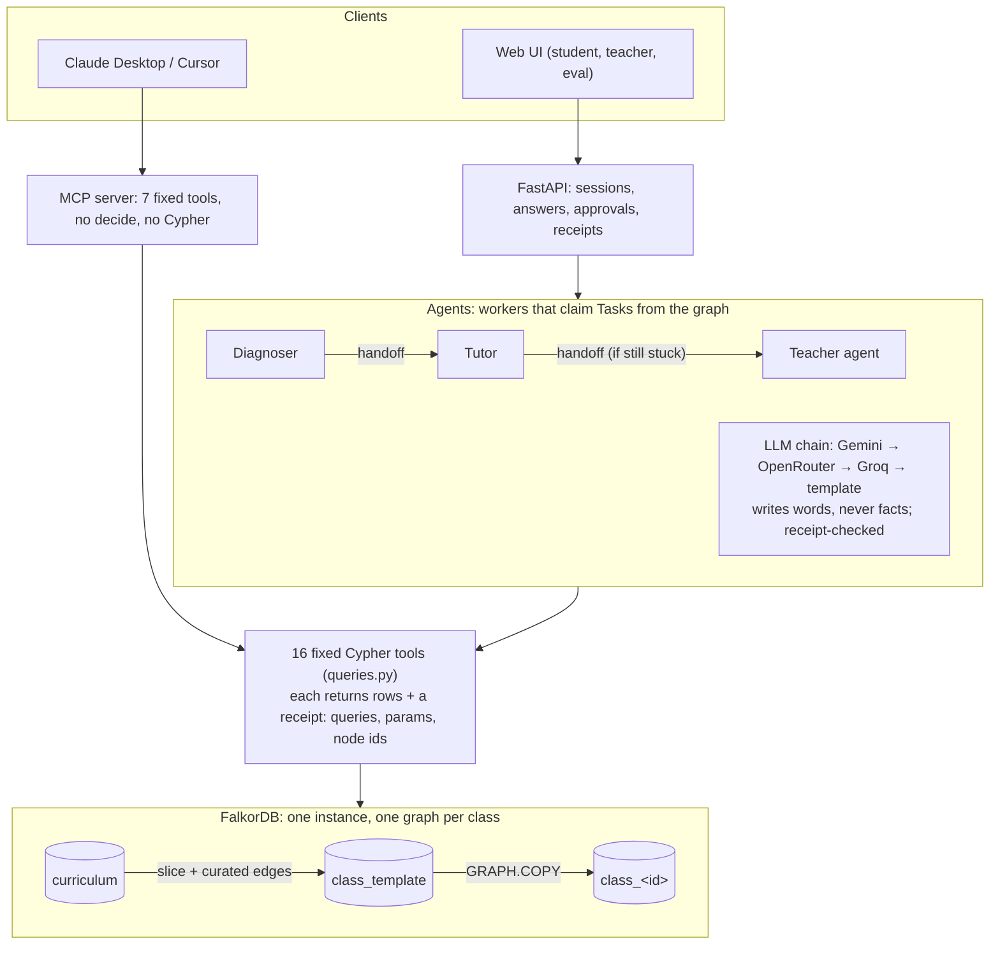

# Unlearn

**Live demo: [unlearn-ejdh.onrender.com](https://unlearn-ejdh.onrender.com)** (free tier: the first load can take about a minute) · **Code: [github.com/pm2m1/unlearn](https://github.com/pm2m1/unlearn)**

> **Remove-FalkorDB test:** without the graph there is no misconception-to-concept grounding, no prerequisite root-cause traversal, no per-class memory, no agent handoffs and no cohort grouping. It collapses into generic chat.

<!-- PARTH: rewrite in your own words -->
Two students both score 40% on fractions and need opposite fixes. Asha can't find a lowest common multiple, a skill from a different topic, two steps below the question she got wrong. Ben changes only the denominator when he makes an equivalent fraction. A chat tutor sees two 40%s. Unlearn asks a few adaptive questions, traces each wrong answer back through a graph of prerequisites to the skill that actually broke, and remembers it next session. Every claim it makes comes with the Cypher query that proves it.

Built for **Graph Hacks (WeMakeDevs × FalkorDB)**. Tracks: **02 Agent Memory and Coordination** (primary) and **01 Agents That Act on Connected Data** (secondary).

## Try it

- **Live demo:** [unlearn-ejdh.onrender.com](https://unlearn-ejdh.onrender.com) (free tier: first load can take about 1 minute; demo state resets on restart). The video's two students are at [`?class=demo_video`](https://unlearn-ejdh.onrender.com/?class=demo_video).
- **Demo video:** <link>
- **Run it locally.** With Docker installed, one command starts it once `.env` exists. Without `.env`, FalkorDB exits on startup because its password is empty. Full steps, including setting a real password, are in [Local setup](#local-setup):

  ```
  cp .env.example .env
  docker compose --profile dev up -d --build --wait
  ```

  Then open **http://localhost:8000**. For the video's two students, run `docker compose exec api python scripts/demo_scenario.py` and open `http://localhost:8000/?class=demo_video`.
- **No API keys needed.** Without them every reply is a template built from the graph's rows. The diagnosis, memory and receipts are the same either way.
- **Explaining it to someone:** [docs/EXPLAIN.md](docs/EXPLAIN.md) is a one-page cheat sheet.

## How Unlearn maps to the tracks

Each row is a track's official key-focus item. "Partial" means some of it is met, and the row says what is missing. Query names are in [`api/unlearn/queries.py`](api/unlearn/queries.py).

**Track 02: Agent Memory and Coordination (primary)**

| Key focus | Met? | What Unlearn does | Proof |
| --- | --- | --- | --- |
| episodic, semantic and procedural memory | Partial | **Episodic:** every answer is an `ATTEMPTED` edge, and each session is a `Session` with `Event`s (attempt, explanation, diagnosis, remediation). **Semantic:** `SHOWED {count, confidence}` and `MASTERED`. **Procedural:** `Skill → Step` with a `success_rate` that every check answer updates, and the Tutor picks the best-rated skill. Partial because the procedures themselves don't change: the 8 skills and their steps are authored (`data/curated/skills.json`). Unlearn learns *which* skill works, never new steps. | `RECORD_ATTEMPT`, `START_SESSION`, `LOG_EVENT`; `UPDATE_SHOWED`, `MARK_MASTERED`; `PICK_SKILL`, `UPDATE_SKILL` |
| persistent conversation history | Partial | What happened in each session persists in the graph across restarts: answers, explanations, the diagnosis and the remediation result. Session 2 opens from it. Partial because the wording isn't kept: the agents' messages aren't stored, so there is no transcript, and the teacher chat answers each message without the earlier turns. | `STUDENT_SESSIONS`, `RECALL`, `SESSION_ATTEMPTS`; `agents/teacher_chat.py` (one turn per call) |
| shared state and handoffs between agents | Yes | Diagnoser, Tutor and Teacher coordinate only through graph state. A `Task` is claimed atomically, completed, and handed off (`HANDED_OFF_FROM`). The Teacher's `Proposal` waits for a human. Each HTTP step reads its state back from the graph; the agents keep none in Python. | `CREATE_TASK`, `CLAIM`, `CLAIM_TASK`, `HANDOFF`, `CHAIN`, `PROPOSE`, `DECIDE`; `tests/test_claim_race.py` |
| high-concurrency reads and writes | Partial | 30 simulated students in each of two class graphs at once: p50 2.1 ms, p95 18 ms per query. Heavy writes on one class barely move another class's p50 (0.33 → 0.57 ms). Partial because it was measured at that small scale, on one laptop. Writes within one class graph queue behind each other (p50 294 ms under heavy writes on the same class), and the server's shared threads raise another class's p95 (0.38 → 28 ms). | `eval/concurrency.py`, [`eval/results/concurrency.json`](eval/results/concurrency.json), `CONC_PROBE_WRITE`, `CONC_HEAVY_WRITE` |
| separate memory per user or tenant | Yes | Each classroom (tenant) is its own graph, copied from `class_template` with `GRAPH.COPY`. Each student's memory is their own `SHOWED`, `MASTERED`, `ATTEMPTED` and `Session` edges inside it. There are no logins, so separation is by graph, not by access control. | `db.recreate_graph` (`GRAPH.COPY`), `scripts/05_new_class.py`, `tools.graph_name` |

**Track 01: Agents That Act on Connected Data (secondary)**

| Key focus | Met? | What Unlearn does | Proof |
| --- | --- | --- | --- |
| multi-hop reasoning | Yes | `root_cause` walks up to 4 `REQUIRES` hops below the target and weighs misconception evidence on each prerequisite. The chain shown on screen is the shortest path to the winner. The Diagnoser descends the prerequisites level by level. | `ROOT_CAUSE`, `ROOT_CAUSE_CHAIN`, `PROBE_FRONTIER`, `LEARNING_PATH`, `LEARNING_PATH_SP` (`algo.SPpaths`) |
| graph queries and algorithms as agent tools | Yes | 16 fixed tools in `api/unlearn/tools.py`. The agents call them and nothing else. The Teacher uses WCC (cohorts), PageRank (keystones) and betweenness (bridges). The Tutor uses shortest paths. `diagnose_text` uses the vector index. | `COHORTS_WCC` (`algo.WCC`), `KEYSTONES` (`algo.pageRank`), `BRIDGES` (`algo.betweenness`), `LEARNING_PATH_SP`, `DIAGNOSE_TEXT` (`db.idx.vector.queryNodes`) |
| tool selection through MCP | Partial | `api/unlearn/unlearn_mcp.py` exposes 7 of the tools (no approve, no Cypher) to MCP clients. Checked over stdio and listed in MCP Inspector. Inside the app, the teacher chat lets an LLM choose among the same 7 tools by function calling, not MCP. Partial because no LLM client has yet been tested choosing tools over MCP (Claude Desktop wasn't tested). The Diagnoser and Tutor call tools in fixed code, not by LLM choice. | `api/unlearn/unlearn_mcp.py`, `tests/test_mcp.py`, [`docs/mcp.md`](docs/mcp.md); `agents/teacher_chat.py` |
| actions based on what the graph shows | Yes | The Diagnoser picks each next question from what the graph has ruled out. The Tutor picks the skill with the best `success_rate`. The Teacher proposes a regroup from a cohort, or practice on a student's root cause; the teacher chat can also propose a skip-ahead. An approved proposal is applied from the graph's own edges and logged as an `Event`. | `NEXT_QUESTION`, `PICK_SKILL`, `PROPOSE`, `DECIDE`, `EXEC_REGROUP`, `EXEC_SKIP_AHEAD`, `EXEC_ASSIGN_PRACTICE`, `LOG_PROPOSAL_EVENT` |
| explainable results | Yes | Every tool call returns a receipt: the query name, its parameters and the rows. The UI shows the Cypher behind each claim. An LLM reply that names anything not in that turn's rows is rejected, retried once, and then replaced by a template built from the rows. | `tools._Receipt`, `llm.check_reply`; the Receipts panel in the web UI |

## Why I built this

<!-- PARTH: rewrite in your own words -->
A percentage tells a teacher how much went wrong, never why. Most wrong answers in maths aren't random: they're a misconception, and the misconception usually lives in an earlier skill. Eedi's misconception graph maps thousands of those misconceptions to the skills they show up in. Add the links between skills, and "why" becomes a graph traversal instead of a guess.

## How it works



- **Diagnoser.** Opens with `recall`, then asks adaptive questions. It searches top-down over `REQUIRES`: a right answer rules out that skill and everything below it, and a wrong answer makes it a suspect to search beneath. It stops when `root_cause` is confident. Every step's state lives in the graph (`Task`, this session's `ATTEMPTED` edges), so each HTTP request runs exactly one step.
- **Tutor.** Explains the root cause with the remediation skill that has worked best so far, asks one check question, and updates that skill's success rate. If the student is still stuck, it hands off to the Teacher agent.
- **Teacher agent.** Looks at cohorts (WCC), keystones (PageRank) and bridges (betweenness), then writes a **Proposal**. Nothing changes until a human approves it. On approval, an executor applies the change from the graph's own edges and logs an `Event`.
- **Receipts everywhere.** Every tool call returns `{cypher, params, rows, node_ids}`. The UI's drawer shows them, and the LLM's words are rejected if they name a construct or misconception that isn't in that turn's rows.
- **The LLM writes words, never facts.**
  - **The chain:** Gemini (`gemini-3.8-flash`, thinking off) → OpenRouter → Groq → template. Each provider is skipped when it has no key.
  - **Checked replies:** a reply must pass the receipt check, have at least 8 words and no bare list markers. A reply that fails gets one retry, then the template takes over.
  - **Free-tier limit:** Gemini's free tier allows 20 requests per model per day. A busy demo uses that up within a few sessions, after which every reply is a template. Nothing breaks, but the wording becomes plainer.

### Design decisions worth knowing
- **Stop thresholds.** The Diagnoser stops when the top root-cause evidence is ≥ 1.5 and leads the runner-up by ≥ 0.5. These are the SPEC's original values, and they follow from the evidence scale: the median prerequisite distractor has weight 1.0, so two hits score 1.5. Looser thresholds (1.0 / 0.33) named the planted root slightly more often on the simulator: 104/115/119 against 102/110/113 of the 139 (root, target) pairs on seeds 0–2 (`eval/design_checks.py`, [`design_checks.json`](eval/results/design_checks.json)). They were not adopted, so the thresholds aren't tuned to the simulator the eval scores against. An earlier version of this note gave 109/126/126 against 103/121/121 of 151; those came from earlier code on the pre-review data.
- **Recall.** `recall` returns every misconception the student has shown. It ranks those on the root cause the student was diagnosed with last session first, then the strongest, then the most recent.
  - **Why it changed:** the build spec kept only misconceptions seen at least twice. That left 58 of 90 simulated students with nothing to recall in session 2.
  - **Chosen after seeing the eval results, stated plainly:** I measured three rules on the same session-1 histories and picked "last diagnosed root first" afterwards. The tutor should open with what it diagnosed last session, and that rule does exactly that.
  - **The cost:** fewer of the named misconceptions are right than under the original rule, because one-off slips get named too.

  Measured by `eval/design_checks.py` on the eval's 90 students ([`design_checks.json`](eval/results/design_checks.json)):

  | `recall` rule | Session-2 opening names a planted misconception | Named misconceptions that were planted |
  | --- | --- | --- |
  | Seen twice (confidence > 0.6), newest first (build spec) | 28% | 78% |
  | Seen once or more, strongest first | 56% | 31% |
  | Seen once or more, last diagnosed root first (**current**) | 68% | 45% |

## Graph data model

Three kinds of graph live in one FalkorDB instance:
- `curriculum`: the full Eedi graph, read-only.
- `class_template`: the Fractions slice plus the curated edges, questions and skills.
- `class_<id>`: one per classroom, made with `GRAPH.COPY`, which carries all 9 indexes, including the vector index.

FalkorDB serialises writes per graph, so classes don't queue behind each other's writes (measured below).

```
// Curriculum (in curriculum and class graphs)
(:Subject {id,name})-[:HAS_TOPIC]->(:Topic {id,name})-[:HAS_SUBTOPIC]->(:SubTopic {id,name})-[:HAS_CONSTRUCT]->(:Construct {id,name,pagerank})
(:Misconception {id,name,embedding})-[:SEEN_IN {pct, w}]->(:Construct)   // w: share of the misconception's pct within the class slice
(:Construct)-[:REQUIRES {source:'curated', weight:1}]->(:Construct)   // (needs)-[:REQUIRES]->(prerequisite)
(:Construct)-[:SHARES_MISCONCEPTION {n}]->(:Construct)                 // curriculum graph only, derived

// Assessment (class graphs)
(:Question {id,text})-[:ASSESSES]->(:Construct)
(:Option {qid,key,text,correct})-[:OPTION_OF]->(:Question)
(:Option)-[:INDICATES]->(:Misconception)                               // wrong options only

// Memory (class graphs)
(:Student {id,alias})-[:ATTEMPTED {ts,session,option,correct}]->(:Question)
(:Student)-[:SHOWED {count,confidence,first_ts,last_ts}]->(:Misconception)
(:Student)-[:MASTERED {ts,evidence}]->(:Construct)
(:Student)-[:HAD_SESSION]->(:Session {id,ts,n})-[:HAD_EVENT]->(:Event {id,type,ts,summary})
(:Event)-[:ABOUT]->(:Misconception|:Construct)
(:Skill {name,success_rate,uses})-[:REMEDIATES]->(:Misconception)
(:Skill)-[:HAS_STEP {order}]->(:Step {text})

// Coordination (class graphs)
(:Agent {name})                                                        // Diagnoser, Tutor, Teacher
(:Task {id,kind,state,claimed_by,created_ts,construct_id,session})-[:ABOUT]->(:Student)
(:Task)-[:ASSIGNED_TO]->(:Agent)
(:Task)-[:HANDED_OFF_FROM]->(:Task)
(:Proposal {id,kind,state,payload})-[:FOR]->(:Student)                  // waits for teacher approval
(:Proposal)-[:HAD_EVENT]->(:Event)                                     // logged when an approval is applied
(:Group {id})-[:HAS_MEMBER]->(:Student)                                // applied regroup
(:Assignment {id,ts,proposal})-[:FOR]->(:Student), (:Assignment)-[:PRACTICES]->(:Construct)
(:Student)-[:SHARES_GAP {miscs}]->(:Student)                            // derived for cohorts
```

| Memory type (Track 02) | Where it lives | Example |
| --- | --- | --- |
| Episodic | `Session`, `Event`, `ATTEMPTED` | "On Oct 17 Asha picked C on q-345-2" |
| Semantic | `SHOWED`, `MASTERED` | "Asha finds a common multiple but not the lowest" |
| Procedural | `Skill` → `Step`, with `success_rate` | "LCM-first common denominators worked 3 of 4 times" |
| Shared state | `Task`, `Proposal` | "Diagnoser handed Asha to the Tutor" |

### The hero query: `root_cause`

```
MATCH (s:Student {id:$sid}), (c:Construct {id:$cid})
MATCH p = (c)-[:REQUIRES*1..4]->(pre:Construct)
WHERE NOT (s)-[:MASTERED]->(pre)
WITH s, pre, min(length(p)) AS depth
OPTIONAL MATCH (s)-[e:SHOWED]->(m:Misconception)-[si:SEEN_IN]->(pre)
WITH pre, depth, sum(coalesce(e.count, 0) * coalesce(e.confidence, 0.0) * coalesce(si.w, 0.0)) AS evidence, collect(DISTINCT m.name) AS miscs
WHERE evidence > 0
RETURN pre.id AS id, pre.name AS name, depth, evidence, miscs
ORDER BY evidence DESC, depth DESC LIMIT 3
```

It walks up to four prerequisite hops back from the skill the student is working on. It ranks every unmastered prerequisite by misconception evidence, weighted by how specific each misconception is to that skill (`SEEN_IN.w`). Ties go to the deeper prerequisite, because the deepest broken skill is the real cause.

## Every query

<!-- queries:start -->
114 queries, all parameterised, all in [`api/unlearn/queries.py`](api/unlearn/queries.py).

**Agent tools (the 16 tools and the queries they run)**

| Query | Purpose | FalkorDB feature |
| --- | --- | --- |
| `RECORD_ATTEMPT` | `record_attempt`: store an answer and return the misconception behind the chosen option | MATCH + CREATE edge |
| `UPDATE_SHOWED` | `record_attempt`: semantic memory, confidence 1 − 0.5^count | MERGE ON CREATE / ON MATCH |
| `MASTERY_EVIDENCE` | `record_attempt`: correct answers and the strongest misconception on a construct | aggregation |
| `MARK_MASTERED` | `record_attempt`: mark MASTERED when earned | MERGE |
| `DIAGNOSE_TEXT` | `diagnose_text`: free-text explanation to this construct's misconceptions | vector index (`db.idx.vector.queryNodes`) + traversal filter |
| `NEXT_QUESTION` | `next_question`: a question not asked this session, fresh first, probing unshown misconceptions | pattern predicates (`NOT (s)-[:ATTEMPTED {session}]->(q)`) |
| `QUESTION_OPTIONS` | `next_question`: the question's options | traversal |
| `ROOT_CAUSE` | `root_cause`: unmastered prerequisites ranked by weighted misconception evidence, deeper wins ties | variable-length `REQUIRES*1..4`, aggregation |
| `ROOT_CAUSE_CHAIN` | `root_cause`: the REQUIRES chain from target to root cause, for the receipt | variable-length path |
| `PROBE_FRONTIER` | `probe_frontier`: deepest unmastered, unprobed prerequisites | variable-length path + pattern predicates |
| `LEARNING_PATH` | `learning_path`: teaching order, deepest first | variable-length `REQUIRES*0..6` |
| `LEARNING_PATH_SP` | `learning_path`: shortest chain to one construct | `algo.SPpaths` |
| `RECALL` | `recall`: misconceptions shown, those on the last diagnosed root first, with their latest events | episodic + semantic traversal |
| `PICK_SKILL` | `pick_skill`: best remediation skill for a misconception | procedural memory |
| `SKILL_STEPS` | `pick_skill`: the skill's ordered steps | traversal |
| `UPDATE_SKILL` | `update_skill`: success rate with a +2/+3 prior | two ordered SETs |
| `SKILL_BY_NAME` | `update_skill`: read the updated skill back | index lookup |
| `COHORTS_CLEAR` | `cohorts`: drop the old gap-sharing edges | DELETE |
| `COHORTS_LINK` | `cohorts`: link students who share a confident misconception | pattern match + CREATE |
| `COHORTS_WCC` | `cohorts`: group students into cohorts | `algo.WCC` |
| `KEYSTONES` | `keystones`: constructs most of the topic depends on | `algo.pageRank` |
| `SET_PAGERANK` | `keystones`: write scores back | UNWIND + SET |
| `BRIDGES` | `bridges`: constructs where misconceptions cross topics (curriculum graph) | `algo.betweenness` (fixed seed) |
| `CLAIM` | `claim`: oldest submitted task for an agent; exactly one worker wins | per-graph write serialisation |
| `HANDOFF` | `handoff`: close a task, open the next, keep the chain and its context | CREATE + SET in one write |
| `PROPOSE` | `propose`: a pending Proposal for the teacher | CREATE + UNWIND |
| `DECIDE` | `decide`: approve or reject a pending proposal | conditional MATCH + SET |

**Approval executor (runs only after `decide(approved)`)**

| Query | Purpose | FalkorDB feature |
| --- | --- | --- |
| `EXEC_REGROUP` | regroup: `(:Group)-[:HAS_MEMBER]->(:Student)` for the proposal's FOR students | MERGE |
| `EXEC_SKIP_AHEAD` | skip_ahead: MASTERED {evidence:'teacher_override'}, never over an earned one | MERGE ON CREATE |
| `EXEC_ASSIGN_PRACTICE` | assign_practice: `(:Assignment)-[:FOR]->(:Student)`, `-[:PRACTICES]->(:Construct)` | CREATE |
| `LOG_PROPOSAL_EVENT` | log the applied change as an Event on the Proposal | CREATE + FOREACH/CASE |

**Sessions, tasks and steppable agents**

| Query | Purpose | FalkorDB feature |
| --- | --- | --- |
| `START_SESSION` | open a Session (n = previous sessions + 1) | aggregation + CREATE |
| `LOG_EVENT` | episodic memory: an Event ABOUT a misconception and/or construct | CREATE + FOREACH/CASE |
| `CREATE_TASK` | the first task of a chain, with its construct and session | CREATE |
| `TASK_CONTEXT` | a task's student, construct, session and pending question | traversal |
| `TASK_STATE` | a task's state (claim-race test) | index lookup |
| `COMPLETE_TASK` | end a chain without handing off | SET |
| `FAIL_TASK` | mark a task failed so the session ends | SET |
| `CLAIM_TASK` | claim one specific task (an HTTP request driving its own session) | per-graph write serialisation |
| `CLAIM_IN_SESSION` | CLAIM limited to one session (simulated sessions) | per-graph write serialisation |
| `OPEN_TASKS_FOR` | read-only check before the API's Teacher worker claims | GRAPH.RO_QUERY |
| `SET_PENDING` | the question a task is waiting on | SET |
| `SET_TUTOR_PLAN` | what the Tutor taught, for the check answer's request | SET |
| `SESSION_TASKS` | a session's tasks (routes an HTTP answer) | property match |
| `SESSION_ATTEMPTS` | this session's answers in order: the Diagnoser's search state | edge property filter |
| `SESSION_RULED_OUT` | constructs answered right this session plus everything they depend on | variable-length `REQUIRES*0..6` |
| `SESSION_LOOKUP` | which student a session belongs to | traversal |
| `STUDENT_SESSIONS` | a student's sessions | traversal |
| `SESSION_SCORE` | correct / answered in one session | aggregation |
| `CHAIN` | every task handed off from a root task | variable-length `HANDED_OFF_FROM*0..` |
| `CHAIN_OPEN` | open tasks in a chain (session end) | variable-length path |
| `SHOWED_ON` | a student's misconceptions on one construct, by weighted evidence | traversal + SEEN_IN.w |
| `STUDENT_SHOWED` | all of a student's SHOWED edges | traversal |
| `NAME_VOCABULARY` | every construct and misconception name, for the LLM receipt check | label scan |
| `PROPOSALS` | proposals by state, with their students | aggregation |
| `PROPOSAL_LOOKUP` | find a proposal's class graph | property match |

**UI, API and demo reads**

| Query | Purpose | FalkorDB feature |
| --- | --- | --- |
| `SLICE_FOR_TARGET` | graph panel: the constructs under a target | variable-length `REQUIRES*0..6` |
| `SLICE_EDGES` | graph panel: REQUIRES edges among them | variable-length path |
| `STUDENT_SHOWED_ON_SLICE` | graph panel: the student's misconceptions on the slice | traversal + IN list |
| `STUDENT_MASTERED_ON_SLICE` | graph panel: mastered constructs | traversal + IN list |
| `CLASS_STUDENTS` | students with their session counts | aggregation |
| `TARGETS` | constructs with prerequisites, deepest chains first (topic picker) | variable-length path + aggregation |
| `QUIZ_SCORES` | fractions-check scores (demo scenario) | edge property filter + aggregation |
| `LOAD_STUDENT_PROFILES` | demo scenario students and their planted simulator profile | UNWIND + MERGE |
| `STUDENT_SIM_PROFILE` | read a scenario student's profile (simulated answers only) | index lookup |
| `COUNT_NODES` | /health node counts | aggregation |
| `RESET_STUDENT_SESSIONS` | demo reset: a student's sessions and events | DETACH DELETE |
| `RESET_STUDENT_EDGES` | demo reset: attempts, evidence, mastery, gap links | multi-type edge match |
| `RESET_STUDENT_TASKS` | demo reset: the student's tasks | DETACH DELETE |
| `RESET_STUDENT_PROPOSALS` | demo reset: proposals, their events and assignments | DETACH DELETE |
| `RESET_STUDENT_GROUPS` | demo reset: group membership | DELETE |

**Eval and concurrency**

| Query | Purpose | FalkorDB feature |
| --- | --- | --- |
| `NEAREST_MISCONCEPTIONS` | the baselines' candidate retriever and the eval judge | vector index |
| `ALL_REQUIRES` | condition B+: every curated REQUIRES edge, as text in the prompt | pattern match |
| `ALL_SEEN_IN` | condition B+: every construct's misconceptions with SEEN_IN.w, as text in the prompt | pattern match |
| `CLASS_CONSTRUCTS` | the eval judge's construct names | label scan |
| `RECALL_SPEC_RULE` | design check: the build spec's recall rule (seen twice, newest first) | pattern match |
| `RECALL_STRONGEST_FIRST` | design check: recall seen once or more, strongest first | pattern match |
| `MISCONCEPTION_NAMES` | design check: planted misconception names | range index lookup |
| `CONC_PROBE_WRITE` | a small timed write (isolation probes) | MERGE |
| `CONC_HEAVY_WRITE` | a deliberately heavy write that holds a graph's write lock | UNWIND + CREATE |

**Loading and indexes**

| Query | Purpose | FalkorDB feature |
| --- | --- | --- |
| `CURRICULUM_INDEXES` | range indexes on Subject/Topic/SubTopic/Construct/Misconception ids | range index |
| `CLASS_INDEXES` | plus Question, Student, Task.state and the 384-d cosine vector index | range + vector index |
| `LOAD_HIERARCHY` | Subject → Topic → SubTopic → Construct from construct-map.csv | UNWIND + MERGE (batches of 500) |
| `LOAD_MISCONCEPTIONS` | misconceptions and weighted SEEN_IN edges | UNWIND + MERGE |
| `LOAD_SHARES_MISCONCEPTION` | derived SHARES_MISCONCEPTION edges (curriculum graph) | UNWIND + MERGE |
| `SLICE_CONSTRUCTS` | the class slice read out of `curriculum` | traversal + IN list |
| `SLICE_SEEN_IN` | the slice's misconceptions and SEEN_IN edges | traversal |
| `SET_SEEN_IN_WEIGHTS` | SEEN_IN.w: the misconception's share of its weight within the slice | aggregation + SET |
| `LOAD_REQUIRES` | curated REQUIRES edges | UNWIND + MERGE |
| `LOAD_QUESTIONS` | questions ASSESSES constructs | UNWIND + MERGE |
| `LOAD_OPTIONS` | options, and INDICATES for wrong ones | UNWIND + FOREACH/CASE |
| `LOAD_SKILLS` | remediation skills | UNWIND + MERGE |
| `LOAD_SKILL_STEPS` | ordered skill steps | UNWIND + CREATE |
| `LOAD_REMEDIATES` | skill → misconception | UNWIND + MERGE |
| `LOAD_AGENTS` | Diagnoser, Tutor, Teacher | UNWIND + MERGE |
| `LOAD_EMBEDDINGS` | misconception embeddings | `vecf32` |
| `LOAD_STUDENTS` | synthetic students | UNWIND + MERGE |

**Checks used by the loaders and tests**

| Query | Purpose | FalkorDB feature |
| --- | --- | --- |
| `COUNT_NODES_BY_LABEL` | node counts per label | aggregation |
| `COUNT_EDGES_BY_TYPE` | edge counts per type | aggregation |
| `COUNT_SEEN_IN` | SEEN_IN count (19,294 expected) | aggregation |
| `COUNT_HIERARCHY_EDGES` | hierarchy edge counts | aggregation |
| `COUNT_SHARES_MISCONCEPTION` | derived edge count | aggregation |
| `ASYMMETRIC_SHARES_MISCONCEPTION` | every derived edge has its reverse | pattern predicate |
| `SEEN_IN_PCT_SUMS` | each misconception's pct sums to 100 | aggregation |
| `LIST_INDEXES` | indexes survive GRAPH.COPY | `db.indexes()` |
| `COUNT_EMBEDDED` | every misconception has a vector | aggregation |
| `REQUIRES_MAX_DEPTH` | longest REQUIRES chain | variable-length path |
| `REQUIRES_PROPS` | REQUIRES edges carry source and weight | aggregation |
| `SHOWED_ON_WEIGHTS` | SEEN_IN pct and w for one misconception | traversal |
| `GROUP_MEMBERS` | approval test read-back | traversal |
| `ASSIGNMENTS_FOR` | approval test read-back | traversal |
| `MASTERED_EDGE` | approval test read-back | traversal |
| `PROPOSAL_EVENTS` | approval test read-back | traversal |
| `COUNT_LABELS` | rejection changes nothing | aggregation |
<!-- queries:end -->

## Evaluation

**Method** (`eval/run_eval.py`, per the build spec):
- **Students:** 30 simulated students × 3 seeds × 2 sessions. All the data is synthetic: the students, their answers and their planted misconceptions.
- **Planted state:** each student has one planted broken prerequisite and 1–3 planted misconceptions.
- **Simulator:** rule-based and seeded (`eval/simulator.py`).
  - If an option shows a planted misconception, the student picks it with probability 0.85.
  - On skills the student knows, they answer correctly with probability 0.9.
  - Otherwise they pick a random wrong option.
  - There is a 10% guess rate everywhere.
- **Conditions:**
  - **A: no memory.** One LLM call per wrong answer. It sees only that question and the misconceptions retrieved for it.
  - **B: vector RAG.** The full attempt history, plus the top-10 misconceptions retrieved from FalkorDB's vector index by embedding each question with the chosen option.
  - **B+: LLM + graph as text.** B's prompt, plus every curated `REQUIRES` edge and every construct's misconceptions with their `SEEN_IN.w` weights, as plain text (about 22,000 tokens). B+ tests whether the graph's value is the *knowledge* in it, which can be pasted into a prompt, or the *traversal* Unlearn runs over it.
  - **C: Unlearn.** The agents, through the same step API the web UI uses.
- **Same model throughout.** A, B and B+ use one local model with no fallback: `qwen3.5:27b-q4_K_M` through Ollama, thinking off. Replies are cached on disk. Cached diagnoses, and A's diagnoses that made no call (a student with no wrong answer), are left out of the latency figures. On the post-review re-run most A and B diagnoses were cache hits (A had 5 fresh diagnoses, B 30), so A's, B's and B+'s latency pools every timed diagnosis from the pre-review and post-review runs (`run_eval.py --pool-latency`). Each fresh call is timed once, in the run that made it. Every latency cell shows its n.
- **Same question pool.** A, B and B+ ask the same seeded 6 questions from the pool C draws from (the target and everything it depends on). C chooses its questions adaptively.
- **Answers are IDs.** A, B and B+ choose from candidate lists with IDs and must reply with IDs. An ID the condition wasn't shown counts as wrong.
  - Root-cause candidates are the target's prerequisites, taken from the curated graph. **That narrows their choice to about 7 skills and favours them.** A random pick is already right 21–24% of the time.
  - Misconception candidates are the retrieved ones for A and B. B+ is scored on every ID it was shown: B's lists plus every misconception and construct in its graph text.
- **Session-2 recall** means the opening message of session 2 names a planted misconception, as judged by embedding distance ≤ 0.35 for every condition. B+ opens exactly as B does, so the two share a recall score.
- **The first run's scoring was replaced** (pre-review data). It asked for free text and snapped every answer to its nearest ID, so a vague answer was still scored as a specific skill. An audit of its cached outputs found no invalid JSON, but 8–14 of about 30 root-cause guesses per condition and seed weren't close to the skill they were scored as. Scoring by offered IDs roughly doubled A's and B's root-cause scores on seed 0 (13% → 27% and 10% → 27%).
- **B+ ran on seed 0 only.** At about 110 s per call, all three seeds would have taken nearly three hours (163 minutes projected), against a 75-minute budget.
- **Correction (Oct 18, pre-review data): B+ re-scored.** B+ was first scored only on IDs from B's retrieved list, although its prompt lists all 410 misconceptions with their IDs. Planted misconceptions it named from the graph text were counted wrong. It was re-scored on every ID it was shown, from the cached model outputs with no new LLM calls (`eval/rescore_bplus.py`). The replay reproduced A's and B's saved predictions exactly, and only B+'s scoring fields changed (14 of 30 students). Results:
  - Top-1 misconception went from 10% to 17%.
  - Top-3 misconception went from 20% to 33%.
  - Root cause stayed at 37%: every planted root is one of the prerequisites B+ was offered anyway.
  - A, B, C, latency and recall are unchanged.
- **Re-run after the human review (Oct 18).** Parth's review of the curated data ([REVIEW.md](REVIEW.md), section 0) deleted 2 `REQUIRES` edges and removed 9 options. Every condition was then re-run on the new data with the same seeds, so all the numbers below are post-review. The simulator draws each student's planted state from the graph, so 14 of the 90 students have a different planted root or misconceptions than before; within the run, every condition still faces the same students. The pre-review run is kept in [`eval/results/eval_pre_review.json`](eval/results/eval_pre_review.json).

**Results** (generated from [`eval/results/eval.json`](eval/results/eval.json) and [`random_baseline.json`](eval/results/random_baseline.json) by `scripts/readme_eval.py`):

<!-- eval:start -->
| Metric | A. No memory (n=90, seeds 0, 1, 2) | B. Vector RAG (n=90, seeds 0, 1, 2) | B+. LLM + graph as text (n=30, seed 0) | C. Unlearn (n=90, seeds 0, 1, 2) | Random guess (A / B / B+) |
| --- | --- | --- | --- | --- | --- |
| Top-1 misconception | 7% (0%–10%) | 7% (3%–13%) | 23% | 48% (43%–50%) | 2.6% / 2.3% / 0.5% |
| Top-3 misconception | 7% (0%–10%) | 13% (7%–27%) | 47% | 79% (73%–90%) | 7.5% / 6.8% / 1.5% |
| Root-cause accuracy | 32% (27%–37%) | 37% (30%–50%) | 40% | 72% (63%–83%) | 23% / 23% / 2.5% |
| Questions to diagnosis | 6.0 | 6.0 | 6.0 | 5.2 (5.1–5.2) | – |
| Session-2 recall | 0% | 9% (7%–10%) | 7% | 57% (50%–70%) | – |
| p50 latency per diagnosis | 14.9 s (n=50) | 7.5 s (n=120) | 113.8 s (n=60) | 50 ms (n=90) | – |
| p95 latency per diagnosis | 32.4 s (n=50) | 9.2 s (n=120) | 130.8 s (n=60) | 61 ms (n=90) | – |

Mean (min–max across seeds) where a condition ran on more than one seed. Model for A, B and B+: `qwen3.5:27b-q4_K_M` (local, Ollama, thinking off), one model, no fallback. C: template wording; its metrics come from the graph.

Latency is p50 / p95 over every diagnosis timed with fresh LLM calls (cached ones are left out), pooled across the pre-review and post-review runs of the same model: n = 45 + 5 for A, 90 + 30 for B and 30 + 30 for B+. C makes no LLM calls; its latency is this run's 90 diagnoses. `n` in a latency cell is the number of diagnoses timed.

**B+ ran on seed 0 only**, so its column above is not comparable with the other columns' three-seed means. On seed 0, the same 30 students for every condition:

| Seed 0 | A. No memory (n=30) | B. Vector RAG (n=30) | B+. LLM + graph as text (n=30) | C. Unlearn (n=30) |
| --- | --- | --- | --- | --- |
| Top-1 misconception | 10% | 13% | 23% | 50% |
| Top-3 misconception | 10% | 27% | 47% | 73% |
| Root-cause accuracy | 33% | 30% | 40% | 63% |
| Questions to diagnosis | 6.0 | 6.0 | 6.0 | 5.2 |
| Session-2 recall | 0% | 7% | 7% | 50% |
| p50 latency per diagnosis | 18.0 s (n=25) | 8.5 s (n=36) | 113.8 s (n=60) | 50 ms (n=30) |

Candidate lists, averaged over the same students: 6.6 root-cause candidates (the target's prerequisites), 9.4 misconception candidates for A and 10 for B. A planted misconception is on A's list for 23% of students and on B's for 20%, which caps A's and B's misconception scores whatever the model does. **B+ is not capped:** it is scored on every ID it was shown, B's lists plus its graph text (410 misconceptions and 40 constructs), and every planted misconception (100%) is in it. The random-guess column picks uniformly from those same sets.

<sup>Footnote: cross-check with `gemini-3.6-flash` on seed 0 (A: n=3, B: n=2), first scoring method, **on the pre-review data** (before REVIEW.md's 2 edge deletions and 9 option removals). **Indicative only, n too small to conclude.** The Gemini free tier allows 20 requests per model per day.</sup>

| Cross-check metric | A. No memory (n=3) | B. Vector RAG (n=2) |
| --- | --- | --- |
| Top-1 misconception | 0% | 0% |
| Top-3 misconception | 0% | 0% |
| Root-cause accuracy | 0% | 50% |
<!-- eval:end -->

**What the table says.**
- **C wins on every metric.** Against A and B, over the same 90 students (seeds 0–2):
  - Root cause: 72% against 32% (A) and 37% (B), and 23% for a random pick from their own lists.
  - Misconceptions: 48% top-1 and 79% top-3, against at most 7% and 13% (B).
  - It asks fewer questions (5.2 against 6) and answers in about 50 ms (n=90) instead of 7.5 s for B (n=120) and 15 s for A (n=50), at p50.
- **B+ tests knowledge against traversal.** It ran on seed 0 only, so it is compared on seed 0's 30 students (the seed-0 table above), never with the three-seed means:
  - **Against B:** B+ beats B on root cause (40% against 30%), top-1 misconception (23% against 13%) and top-3 (47% against 27%). So the graph's knowledge does help an LLM.
  - **Against C:** it's still far behind: 40% against 63% on root cause, 23% against 50% on top-1 and 47% against 73% on top-3. Pasting the graph into the prompt doesn't reproduce what traversing it does. On seed 0, a B+ diagnosis takes 114 s at p50 (n=60), against 8.5 s for B (n=36) and 50 ms for C (n=30).
- **B+ is not close to C on any seed-0 metric**, so no claim needs narrowing on that count.
- **Session-2 recall.** Over seeds 0–2, C scores 57% against 9% for B and 0% for A. On seed 0, C scores 50% against 7% for both B and B+, whose openings are identical.
  - The eval's figure comes from the embedding judge applied to the real opening text.
  - The 68% in the recall table under "Design decisions worth knowing" counts the named IDs exactly. The two measure slightly different things.

**Simulator bias, stated plainly.**
- **It favours Unlearn.** The simulator picks wrong answers through the same option-to-misconception map Unlearn reads, and a real student's wrong answers are messier than the map. The noise (a 10% guess rate, 15% of planted misconceptions not picked) blunts that bias without removing it.
- **A stronger model may narrow the gap** on naming misconceptions. The baselines here run on a 27B local model.

### Concurrency (`eval/concurrency.py`, [`eval/results/concurrency.json`](eval/results/concurrency.json))

**Both classes at once.** 30 simulated students in each of two class graphs ran at the same time through the async client. Per graph, p50 was 2.1 ms and p95 18 ms across 360 answers' worth of queries.

**Isolation.** These are small probe writes into class A, timed from a separate process with its own connection:

| Load while probing class A | p50 ms | p95 ms |
| --- | --- | --- |
| None (baseline) | 0.33 | 0.38 |
| Heavy writes on **class B** | 0.57 | 28.3 |
| Heavy writes on **class A** | 294 | 569 |
| 30 students' sessions on class B | 70 | 79 |
| 30 students' sessions on class A | 70 | 77 |

- **Write locks are per graph.** A's writes don't queue behind B's writes, only behind A's own.
- **Threads and CPU are shared.** A load that fills the server's query thread pool (`THREAD_COUNT` 15 here) slows every class equally.

Tool latency for all 16 tools, 50 calls each, is in [`eval/results/latency.json`](eval/results/latency.json). Every class-graph tool is under 5 ms at p95.

## How Unlearn differs from Atrium

Atrium won FalkorDB's own "Memory Meets Motion" hackathon ([FalkorDB's recap](https://www.falkordb.com/blog/memory-meets-motion-the-falkordb-standouts/)) by grouping students by misconception. Unlearn keeps that grouping (`cohorts`, WCC over shared misconceptions) and adds what a grouping can't tell a teacher:
- **Why.** `root_cause` traverses prerequisites to the skill that broke, often in another topic.
- **Memory across sessions.** Session 2 opens with what session 1 found.
- **Multi-agent handoff through the graph.** Tasks are claimed, handed off and approved, all as graph state.
- **A human approval gate.** Nothing the agents propose takes effect until a teacher approves it.
- **An MCP server** over the same fixed tools.
- **A measured eval** against vector RAG and no memory.

## Data, licences and what is synthetic

| Source | What | Status | Licence |
| --- | --- | --- | --- |
| [Eedi Misconceptions Graph v1.0](https://huggingface.co/datasets/Eedi/Eedi-Misconceptions-Graph), pinned to commit `2ae0839debf73c0ce7dd6578d8ea8b99e7be8631` | 2,258 constructs (Subject → Topic → SubTopic hierarchy), 8,117 misconceptions, 19,294 weighted misconception↔construct edges | Real | [CC BY 4.0](https://creativecommons.org/licenses/by/4.0/) |
| `data/curated/requires.csv` | 57 prerequisite edges between 40 constructs (10 of 57 marked medium or low confidence) | Authored (AI draft, human review: 2 edges deleted, see [REVIEW.md](REVIEW.md)) | MIT (this repo) |
| `data/curated/questions.json` | 120 multiple-choice questions, each wrong option tied to an Eedi misconception, maths checked with `fractions.Fraction` | Authored (AI draft, human review: 9 options removed, see [REVIEW.md](REVIEW.md)) | MIT |
| `data/curated/skills.json` | 8 remediation skills | Authored (AI draft, human review) | MIT |
| Students, attempts, sessions | 30 simulated students in `class_demo`, Asha and Ben in `class_demo_video` | Synthetic | MIT |

**Attribution** (required by the licence):

> "[Eedi Misconceptions Graph v1.0](https://huggingface.co/datasets/Eedi/Eedi-Misconceptions-Graph)" by Eedi, licensed under [CC BY 4.0](https://creativecommons.org/licenses/by/4.0/). Adapted: filtered to Number/Fractions for the class graphs, with curated prerequisite edges and generated questions added.

Eedi does not endorse this project. There are no real students, logins or personal data anywhere.

## Known FalkorDB issues we hit (v4.20.7) and the workarounds

| Issue | Workaround |
| --- | --- |
| `ORDER BY length(p)` on a path that isn't returned fails: "Unable to locate a value with alias p" | Return `length(p) AS hops` and order by `hops` (`ROOT_CAUSE_CHAIN`) |
| `ORDER BY` a property not projected after an aggregation fails: "cannot reference variables not projected" | Project it first (`PROPOSALS` returns `created_ts`) |
| `GRAPH.COPY` segfaulted once (signal 11) during rapid delete-and-copy cycles straight after heavy writes. It was not reproducible on its own, even with 60 back-to-back copies | Compose uses `restart: unless-stopped`; the data survived on the volume. `demo_scenario.py` retries the copy once |
| On Render, FalkorDB logged "Possible SECURITY ATTACK detected … Connection from 127.0.0.1 aborted" about every 60 s. It was bound to 127.0.0.1, so the connection came from inside the container, and our code never sends HTTP to it. Redis logs this line when it receives an HTTP request, and one local HTTP request to 127.0.0.1:6379 reproduced it, so it fits Render's port detection probing every listening port | The Render image runs FalkorDB on a unix socket only (`--port 0`, `FALKOR_SOCKET`), so nothing can probe it over TCP. The local compose setup is unchanged |
| `GRAPH.COPY` failed once with "could not fork" while a script was copying a class graph many times in a row. The server was healthy straight after (no save or fork in progress) and the same copy succeeded on retry | `recreate_graph` waits and retries the copy on "could not fork", as it does on "already set" |
| A write query against a graph that was just deleted silently recreates it, empty. Our Teacher worker's polling `CLAIM` did this to test graphs, and once, between a delete and a `GRAPH.COPY` onto that name, it made the copy fail with "key is already set" | Poll with `GRAPH.RO_QUERY` first (`OPEN_TASKS_FOR`) and claim only when a task is waiting. Scripts that rebuild a class run the Teacher themselves, so no task is left waiting, and retry the copy on "already set" |
| The image's default `MAX_QUEUED_QUERIES 25` rejected 60 concurrent simulated students: "Max pending queries exceeded" | Compose sets `FALKORDB_ARGS=MAX_QUEUED_QUERIES 256 TIMEOUT 1000 RESULTSET_SIZE 10000`. It restates the other defaults, because setting the variable replaces them |
| The vector query's `score` is a cosine **distance**: the exact text scores 0.0 | `ORDER BY score ASC`, checked by a test |
| `LIMIT` doesn't limit eager operations that come before it | `CLAIM` limits before it writes; 20 rounds of 10 concurrent claims each have exactly one winner |
| All graphs share one query thread pool, so a saturating load on any class slows every class | A capacity limit rather than a bug; the measured numbers are above |

Good news: `GRAPH.COPY` carries every index, including the vector index, into the new class graph. `algo.SPpaths`, `algo.WCC`, `algo.pageRank` and seeded `algo.betweenness` all ran unchanged.

## Local setup

You need Docker with Compose v2 (Docker Desktop, or Docker Engine with the compose plugin) and `git`. Nothing else: Python, FalkorDB, the embedding model and the Eedi data all come from the containers.

```
git clone https://github.com/pm2m1/unlearn.git
cd unlearn
cp .env.example .env
sed -i.bak "s/^FALKOR_PASSWORD=.*/FALKOR_PASSWORD=$(openssl rand -hex 16)/" .env && rm .env.bak
docker compose --profile dev up -d --build --wait
```

Then open **http://localhost:8000**.

- **First run.** `--build` takes a few minutes and bakes the embedding model and the pinned Eedi CSVs into the image. On first boot the API seeds every graph before it reports healthy (under a minute), and `--wait` returns once it has. Later starts take seconds.
- **Check it.** `curl -s localhost:8000/health` lists the graphs (`curriculum`, `class_template`, `class_demo`), their node counts and the FalkorDB version.
- **Fill the teacher view.** Open the Teacher tab and click "Simulate the class", or run `curl -X POST localhost:8000/classes/demo/simulate-all`.
- **The demo video's scenario.** Run `docker compose exec api python scripts/demo_scenario.py`, then open `http://localhost:8000/?class=demo_video`. Asha and Ben both score 40% and have different root causes; `--verify 10` replays both students 10 times.
- **Stop it.** `docker compose --profile dev down`. The graphs stay in the `falkor-data` volume. Add `-v` to wipe them; the next start re-seeds itself.
- **Optional LLMs.** Put any of `GROQ_API_KEY`, `GEMINI_API_KEY` or `OPENROUTER_API_KEY` in `.env` before starting. Without them, every reply is a template built from the graph's rows.
- **A local model instead (dev profile only).** With [Ollama](https://ollama.com) running on the host, set `OLLAMA_BASE_URL=http://host.docker.internal:11434/v1` (and optionally `OLLAMA_MODEL`) in `.env` and run the `up` command again. The app then tries the local model first. The `prod` profile never passes it.

Both containers bind to `127.0.0.1` in the `dev` profile. `docker compose --profile prod up -d --build --wait` publishes only the API on port 8000; FalkorDB has no published port.

### The live demo (Render free tier)

[`render.yaml`](render.yaml) deploys [`deploy/Dockerfile.render`](deploy/Dockerfile.render): one container running FalkorDB v4.20.7 and the API. FalkorDB listens only on a unix socket inside the container, with no TCP port. The free tier has 512 MB of RAM, no disk, and sleeps after 15 minutes idle.
- **Baked graphs.** `curriculum`, `class_template`, `class_demo` and `class_demo_video` are built at image build time and saved as `dump.rdb`, so a cold start loads them in seconds. Nothing is ever saved, so demo state resets on every restart.
- **Measured locally under the free tier's limits** (`docker run --memory=512m --memory-swap=512m --cpus=0.1`):
  - Healthy 19 s after start.
  - `demo_scenario.py --verify 10` correct 10/10.
  - Peak memory 381 MiB, over that run, a full session flow through the API and "Simulate the class".
- **Slow at 0.1 CPU.** `bridges` (betweenness over the curriculum graph) takes about 7 s, so the image raises FalkorDB's query timeout to 30 s. "Simulate the class" (60 sessions) takes about 6 minutes.
- **Protecting the free LLM quota:**
  - `UNLEARN_RATE_LIMIT_PER_IP`: 60 requests per address per 10 minutes on the routes that can call the LLM; over that, a 429.
  - `UNLEARN_LLM_DAILY_CAP`: 40 uncached LLM calls per day for the instance, after which replies are templates. A spoofed `X-Forwarded-For` can get past the per-address limit, but not this cap.
  - `UNLEARN_SIMULATE_TEMPLATE`: simulations never call the LLM.
  - All three are off unless set, so local runs are unaffected.

### Working on the code (host Python)

```
python3.12 -m venv .venv && .venv/bin/pip install -r requirements.txt
make up      # FalkorDB only, on 127.0.0.1:6379
make seed    # load curriculum, build class_template, create class_demo
make test
make serve   # the API and UI on http://localhost:8000
```

## MCP server

`api/unlearn/unlearn_mcp.py` exposes `recall`, `root_cause`, `learning_path`, `cohorts`, `keystones`, `bridges` and `propose` to MCP clients. Every tool takes a `class_id`.
- **Not exposed:** `decide`. Approval stays with the human.
- **No raw Cypher.** That's why Unlearn doesn't use FalkorDB's own MCP server, which runs arbitrary queries. Fixed domain tools keep "tool selection through MCP" safe.

Claude Desktop config (`claude_desktop_config.json`), with your clone's absolute paths:

```json
{
  "mcpServers": {
    "unlearn": {
      "command": "/ABSOLUTE/PATH/TO/unlearn/.venv/bin/python",
      "args": ["-m", "unlearn.unlearn_mcp"],
      "env": { "PYTHONPATH": "/ABSOLUTE/PATH/TO/unlearn/api" }
    }
  }
}
```

More in [docs/mcp.md](docs/mcp.md).

## AI assistance

AI assistant use is disclosed in [AI_USAGE.md](AI_USAGE.md).

## Licence

MIT for the code and the authored data. Eedi data is CC BY 4.0, attributed above.
